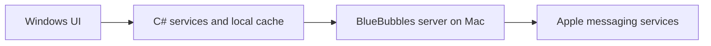
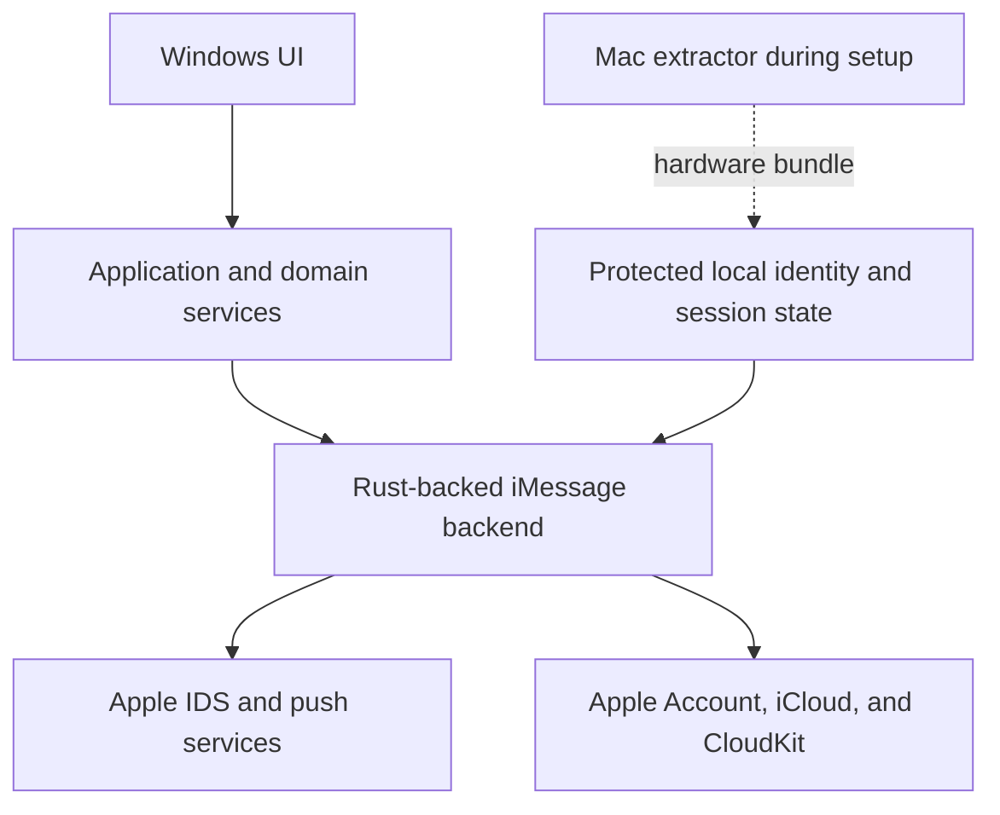

# Native iMessage Pivot

Research and direction record for a possible move from the BlueBubbles relay model
to a native iMessage client built around OpenBubbles/rustpush.

- Recorded: 2026-10-23.
- Status: exploration and feasibility planning, not an implemented migration.
- Project context: an independent personal project.
- Canonical integration reference: Corten-Matrix, as selected by the maintainer
  following its endorsement in the OpenBubbles Discord.
- Verification boundary: upstream source, build configuration, documentation,
  release metadata, and maintainer messages have been inspected. We have not built
  a Windows rustpush client or performed live Apple activation, authentication,
  registration renewal, messaging, or iCloud synchronization.

## Contents

1. [Summary and Scope](#summary-and-scope)
2. [Motivation](#motivation)
3. [Current and Proposed Models](#current-and-proposed-models)
4. [Reference Projects](#reference-projects)
5. [Hardware Identity, FairPlay, NAC, and Anisette](#hardware-identity-fairplay-nac-and-anisette)
6. [Corten Findings and Corrections](#corten-findings-and-corrections)
7. [Expected Setup and Session Lifecycle](#expected-setup-and-session-lifecycle)
8. [Windows Integration](#windows-integration)
9. [Sync Ownership and Correctness](#sync-ownership-and-correctness)
10. [Security and Operational Risks](#security-and-operational-risks)
11. [Reuse and UI Direction](#reuse-and-ui-direction)
12. [Feasibility and Migration Gates](#feasibility-and-migration-gates)
13. [Decisions and Open Questions](#decisions-and-open-questions)
14. [Proposed Next Task](#proposed-next-task)
15. [Evidence and Source Register](#evidence-and-source-register)

## Summary and Scope

The proposed pivot is away from **BlueBubbles' client-server method** and toward
**OpenBubbles/rustpush's native iMessage client model**. These names are not
interchangeable: OpenBubbles already uses rustpush; the existing Windows app talks
to a BlueBubbles server running on a Mac.

The principal architectural benefit is direct ownership of the client-side
messaging and sync lifecycle. The Windows client would communicate with Apple's
services through a Rust protocol implementation rather than treating a Mac-hosted
BlueBubbles API and its database view as the intermediary.

This does not mean that the Windows client becomes authoritative over Apple's
data. It means that the client owns its local state, event ingestion, outbound
intent, synchronization progress, and reconciliation with the remote protocols.

The maintainer expects that substantial parts of the app may be rewritten. There
is no requirement to preserve the current screen structure or the current service
boundaries simply because they already exist. Conversely, there is no requirement
to discard tested, protocol-independent logic that remains useful.

This document does not authorize a bulk rewrite, a new frontend framework, a
dependency installation, a release, or a change to the current app's behavior.
Existing architecture and packaging rules in [CLAUDE.md](../CLAUDE.md) remain in
force until explicitly changed. The historical no-rewrite decision in
[PUNCHLIST.md](PUNCHLIST.md) remains an accurate record of the earlier audit; this
document records a different product/backend direction without rewriting that
history or declaring all earlier code obsolete.

License compliance is treated as settled based on the maintainer's statement.
The outstanding work is technical feasibility, integration, and product design.
Normal dependency provenance, notices, and artifact tracking still belong in the
engineering process; repeatedly reopening the project's licensing decision does
not.

## Motivation

### Direct Control of Sync

The current client can improve its own cache and reconciliation logic, but its
remote view is limited to what the BlueBubbles server exposes and delivers.
Moving the protocol engine into the client gives the project control over how
live Apple events and iCloud history are ingested, persisted, reconciled, and
presented.

Rustpush exposes more than real-time message delivery. Its
[Cloud Messages implementation](https://github.com/OpenBubbles/rustpush/blob/master/src/imessage/cloud_messages.rs)
includes chat, message, and attachment synchronization, continuation tokens, and
record-removal information. This makes direct history synchronization a concrete
integration possibility, not merely an aspiration inferred from live push support.

API availability does not establish completeness or reliability. Reconnect
recovery, ordering, deletion convergence, attachment fidelity, and cross-device
behavior must still be demonstrated in our client.

### Maintenance and Independence

The maintainer's concern is that the BlueBubbles server's release cadence has
slowed while rustpush continues to receive protocol-related work.

The evidence inspected during this discussion was:

| Project | Inspected evidence | Interpretation |
| --- | --- | --- |
| BlueBubbles Server | Latest release was v1.9.9, published 2025-05-16. | The published release was more than a year old on the research date. |
| BlueBubbles Server | Latest inspected default-branch commit was dated 2026-07-18. | Old releases do not establish that all development has stopped. |
| OpenBubbles/rustpush | Latest inspected commit was dated 2026-10-12, with message `AppleAccount fixes`. | There is recent protocol/authentication maintenance. |
| Corten-Matrix | Release 1.3.5 was published 2026-10-09. | There is an actively used downstream integration to investigate. |

These are dated observations, not promises of future support. Direct connectivity
exchanges a relay dependency for responsibility for Apple's changing private
protocols and the health of the chosen upstream implementation.

### Product and UI Opportunity

The maintainer is not satisfied with much of the present UI. The backend pivot is
also an opportunity to reconsider the app's structure and visual character.
Detailed design is currently deferred, but the preferences and retention targets
are recorded below so they are not lost during backend exploration.

## Current and Proposed Models

### Current: BlueBubbles Relay

The app's current [README](../README.md) describes this shipped model. The Core
project speaks REST and Socket.IO to the Mac server; the app does not currently
talk directly to Apple.

The current [SyncService](../BlueBubbles.Core/Services/SyncService.cs) makes this
dependency concrete: it requests chat/message pages from `IBlueBubblesApiService`,
uses server data for reconciliation, and can advance incremental sync using the
Mac message database's `ROWID`. Its full-sync path also fetches Firebase config.
This is more than interchangeable socket plumbing.

### Proposed: Native Client

This is a conceptual ownership diagram, not an exact request sequence or a
decision about DLL versus process integration.

The desired outcome is direct messaging and history access from the Windows
machine. A Mac would supply the required hardware material during setup rather
than relay every message. Corten documents such a one-time-extraction model for
its current Linux releases. Equivalent native Windows behavior is a goal to
prove, not a capability already established here.

Matrix is not a proposed runtime dependency for this app. The bridge is useful
because it demonstrates a substantial rustpush integration. We want to learn from
its authentication, registration, state management, sync, and FFI boundaries
without importing homeservers, Matrix rooms, bridge bots, or bridge-specific
delivery constraints into a standalone Windows client.

## Reference Projects

| Project | Role in this investigation | Important boundary |
| --- | --- | --- |
| [OpenBubbles/rustpush](https://github.com/OpenBubbles/rustpush) | Underlying Apple protocol library. | A library and its public checkout are not the same thing as a fully configured client. |
| [lrhodin/corten-matrix](https://github.com/lrhodin/corten-matrix) | Canonical integration reference selected by the maintainer; formerly `lrhodin/imessage`. | Its Go/Matrix application layer is not our target application architecture. |
| [jasonlaguidice/imessage](https://github.com/jasonlaguidice/imessage) | Secondary Corten fork with useful public validation and Windows development work. | Its behavior and source layout must not be assumed identical to current Corten. |
| [OpenBubbles/openbubbles-app](https://github.com/OpenBubbles/openbubbles-app) | Native-client setup and protocol-integration reference. | Its Flutter architecture and UX are not requirements for this app. |
| [JJTech0130/pypush](https://github.com/JJTech0130/pypush) | Historical protocol and FairPlay reference mentioned by maintainers. | Current pypush is undergoing a rewrite; do not infer feature parity from its history. |
| [JJTech0130/nacserver](https://github.com/JJTech0130/nacserver) | Related validation research referenced by the emulator-based fork. | A research component is not evidence of a supported Windows client. |
| [beeper/imessage](https://github.com/beeper/imessage) | Historical direct-connect bridge and registration reference. | Separate Go implementation, archived in April 2025; not the current rustpush integration target. |
| [beeper/mac-registration-provider](https://github.com/beeper/mac-registration-provider) | Historical live-Mac validation provider. | Archived in April 2026, with version-specific macOS support. |

Beeper's [platform-imessage related-project list](https://github.com/beeper/platform-imessage)
links Corten, rustpush, pypush, and the older bridges. This establishes a useful
technical relationship/reference network, not a formal support agreement or an
assurance that one project's artifacts can be embedded in another.

## Hardware Identity, FairPlay, NAC, and Anisette

These requirements solve different problems. They should not be collapsed into
one unspecified "Apple key" or treated as replacements for one another.

| Component | Purpose | How the user encounters it |
| --- | --- | --- |
| Mac hardware bundle | Supplies genuine machine identity and associated material used by the selected implementation. | Run an extractor on a Mac and import its output into the client. |
| FairPlay certificate/key material | Signs the activation request used to obtain a client push identity. | Normally a developer/build provisioning concern, not something every user should locate manually. |
| NAC validation | Supplies the device-validation data required by the iMessage registration protocol. | Should happen inside the client during registration and renewal. |
| Anisette | Supplies device-related authentication data for Apple Account/iCloud requests. | Should be generated through a provider as part of authentication operations. |
| Apple Account credentials and verification | Authorizes access to the user's account. | Account sign-in, password, and any required verification. |
| Messaging/session keys and tokens | Maintain the enrolled client identity, authenticated sessions, and protocol encryption. | Persisted and protected by the client; not interchangeable with the extractor output. |

### The Mac Extractor and Its Hardware Bundle

The app run on the Mac to generate an activation code/key is the user-visible
bootstrap step discussed here. Corten provides
[hardware extraction tools](https://github.com/lrhodin/corten-matrix/tree/master/tools).
OpenBubbles also documents its own hardware-info setup flow.

The exported value is a container for hardware identifiers and associated
machine-specific material. The exact fields, encoding, and enrichment depend on
the extractor and backend version. Base64 is a transport encoding, not a promise
that the bundle is encrypted or safe to publish.

The bundle is not an Apple Account password, a permanent account login token, a
2FA bypass, or a universal message-decryption key. Importing it does not replace
account authentication. It gives the implementation material with which to
present an appropriate device identity and generate required validation data.

Compatibility is not automatic. A Corten extractor output, an older Corten key,
and an OpenBubbles activation code may use different schemas or require different
enrichment. Corten's documentation explicitly distinguishes older and newer
extractor outputs. Select a matching extractor/backend pair and test it.

Treat the bundle as sensitive even though it is not an account password. Sharing
it also shares a machine identity, with possible consequences for the hardware
owner if that identity is misused or blocked.

### FairPlay Activation Material

The missing `certs/fairplay` directory was the specific limitation the maintainer
remembered. Rustpush's
[activation implementation](https://github.com/OpenBubbles/rustpush/blob/master/src/activation.rs)
includes named certificate/key pairs at build time and uses a pair to sign the
activation request. The resulting push identity is distinct from Apple Account
sign-in and from IDS registration.

The numbered FairPlay directory is excluded from the public checkout, but the
[upstream build workflow](https://github.com/OpenBubbles/rustpush/blob/master/.github/workflows/build.yml)
shows how its expected files are provisioned: copy the bundled legacy pair into
the numbered certificate and key slots.

The maintainer supplied Discord screenshots in which project maintainers point
contributors to pypush and to this workflow, and explicitly say the dummy files
work. This is important evidence: the workflow's "fake" label must not be used to
conclude that the supplied files only compile and cannot activate.

Practical interpretation:

- FairPlay is a known provisioning step, not presently established as an
  unavailable dependency blocking the entire pivot.
- Follow the selected upstream revision's recipe, filenames, and byte formats.
  Do not arbitrarily base64-decode or otherwise transform files based on their
  extension or appearance.
- Keep the provenance and revision of the material reproducible.
- Do not place certificate/key contents, account secrets, or hardware bundles in
  this document, logs, screenshots, issues, or source control.
- Maintainer confirmation is not a live activation test performed by this project.
  The Windows feasibility test must still establish runtime success.

### NAC: iMessage Device Validation

NAC supplies validation data for registering a client with Apple's iMessage
identity service, IDS. At a high level it answers whether the client can produce
the device-validation data Apple expects for the presented identity.

The hardware bundle is input/state. NAC validation is a protocol operation that
uses the selected implementation and that state to generate the required data.
It is not adequately modeled as a permanent string pasted once and reused for
every future operation. The registration lifecycle includes renewal, and the
implementation must remain able to complete the relevant exchanges.

There are multiple implementation approaches in this ecosystem:

- Calling Apple's native frameworks while running on a real Mac.
- Asking a live Mac provider/relay to supply validation data.
- Running an emulator-based implementation on another host.
- Using the clean-room Rust implementation declared by the current Corten source.

These approaches have different host requirements. A live-Mac provider can remove
the need for a full messaging relay without removing every ongoing Mac
dependency. A local implementation supplied with suitable extracted material is
the route toward one-time Mac setup and independent ongoing operation.

The public [OpenAbsinthe stub](https://github.com/OpenBubbles/OpenAbsinthe-Stub)
really is nonfunctional: its README says so, and inspected methods contained
`todo!()`. That establishes the limits of that particular dependency, not the
absence of every public or independently usable validation implementation.

### Anisette: Apple Account Authentication Context

Anisette supplies device-related authentication information used in certain Apple
Account and iCloud requests. It accompanies authentication rather than replacing
the user's account credentials or verification requirements.

The client obtains this information through an Anisette provider. Depending on
the implementation and configuration, the provider can use a local implementation,
Apple's native macOS facilities, or a remote service. In normal product UX the
user should not have to generate a separate Anisette code on a Mac and paste it
into the Windows client.

ClearADI is the relevant local implementation family in the current Corten
configuration. A remote Anisette service is an alternative provider, not the same
thing as a BlueBubbles messaging server. Nevertheless, it is an additional
operational/trust dependency and should not be introduced by assumption.

Anisette state must be preserved deliberately. Corten's inspected
[fallback-provider implementation](https://github.com/lrhodin/corten-matrix/blob/master/pkg/rustpushgo/src/anisette.rs)
explains that repeatedly deleting provisioning state can create a new device
identity and trigger additional verification. A transient provider failure is
not automatically evidence that the stored identity should be wiped.

Important limits:

- Anisette does not replace NAC registration validation.
- Neither mechanism replaces Apple Account authentication.
- The hardware extractor is not itself the entire ongoing Anisette service.
- Generating some authentication context locally does not mean the client can
  authenticate or register without contacting Apple.
- Whether a remote provider sees account-related information must be determined
  from its actual protocol and implementation. Do not assert that passwords or
  tokens can never reach it without reviewing that data flow.

## Corten Findings and Corrections

### Current Source Configuration

The latest Corten
[Rust wrapper manifest inspected in this discussion](https://github.com/lrhodin/corten-matrix/blob/master/pkg/rustpushgo/Cargo.toml)
declares `cleanroom-registration` as its default feature set. It selects:

- `open-absinthe/native-nac-rust` for NAC, described by the manifest as pure Rust
  without a Unicorn emulator or an Apple framework requirement.
- ClearADI-backed Anisette through the `remote-clearadi` feature family in
  rustpush, `icloud_auth`, and `omnisette`.
- Optional fallback features for Apple's native NAC framework, macOS AOSKit
  Anisette, and legacy remote Anisette v3.

**Critical qualification from the public dependency:** the inspected
[OpenAbsinthe manifest in the same Corten repository](https://github.com/lrhodin/corten-matrix/blob/master/rustpush/open-absinthe/Cargo.toml)
defines `native-nac-rust = []` and explicitly describes it as a no-op placeholder
for resolving the wrapper's feature reference. It identifies `native-nac`, which
delegates to Apple's macOS framework, as the functional public macOS path.

An empty Cargo feature can legitimately select implementation code elsewhere, so
the empty list alone would not prove a stub. Here the manifest's explicit no-op
description is the important evidence. The wrapper's declaration of a clean-room
default is not evidence that a complete portable NAC implementation is supplied
by this public overlay.

Consequently, the earlier conversational suggestion that current Corten source
already removes the need for a platform-specific NAC implementation was too
strong. A functioning implementation or suitable Windows artifact must still be
identified. The clean-room feature declaration is an integration lead, not a
passed availability or Windows-runtime gate.

Names are not sufficient evidence of network topology. In particular, the
`remote-clearadi` feature name does not by itself establish that our app must
depend on a public Anisette server. Inspect the selected provider and its runtime
behavior rather than inferring requirements from a feature label.

These are source/configuration observations. They do not prove that the complete
dependency graph builds on Windows, that every implementation path is functional,
or that the same features were used to produce a particular published artifact.

### Documentation and Release Mismatch

Earlier inspected Corten documentation described a macOS-native source build and
Linux prebuilt releases with no public Linux source-build route. The subsequently
inspected wrapper manifest declares a broader clean-room default, but the public
OpenAbsinthe overlay marks its corresponding Rust feature as a no-op. This is
not merely evidence of a stale README; source/build variants and implementation
availability need to be resolved. Those descriptions must not be silently
combined as though they describe one verified build.

Before implementing against Corten:

1. Record the exact Corten commit, rustpush revision, dependency revisions, and
   enabled feature set.
2. Inspect the implementation selected by those features, not just manifest
   comments or a README from a different revision.
3. Distinguish the default branch from a release tag and from any private release
   build overlays.
4. Establish what can be reproduced from public source at that pinned revision.
5. Run the intended Windows build and authentication tests.

The inspected Corten 1.3.5 release offered macOS, Linux amd64, and Linux arm64
executables. No Windows executable or standalone Windows validation DLL was
established by that release inspection. A complete Linux bridge binary is not a
library that can be loaded directly into a Windows C# process.

### Secondary Fork Findings

Jason's fork retains an
[emulator-based OpenAbsinthe implementation](https://github.com/jasonlaguidice/imessage/tree/master/rustpush/open-absinthe)
whose README describes running Apple's `IMDAppleServices` through Unicorn with
extracted hardware data. Its inspected build script enables certain supporting
code only for x86_64/aarch64 Linux targets.

The fork also contains
[Windows development scripts](https://github.com/jasonlaguidice/imessage/tree/master/dev)
for an MSVC environment, Rust static-library builds, and UniFFI Go binding
generation. These are useful evidence of Windows-oriented development work, not
proof of successful native Windows registration and renewal.

Its documented Intel-key versus Apple Silicon live-relay distinction must not be
transferred to current Corten, whose documented Linux releases describe a newer
one-time extraction model for both kinds of Mac.

### Corrections to Preserve

The investigation changed several initial assessments:

| Initial assessment | Corrected position |
| --- | --- |
| Missing FairPlay files might require unavailable private material. | Upstream provides a provisioning recipe, and supplied maintainer messages endorse the legacy/dummy files as working. Test that recipe before declaring a blocker. |
| A nonfunctional public OpenAbsinthe stub blocks all independent clients. | It blocks that specific implementation path. Other native, relay, emulator, and clean-room paths exist or are declared by the inspected source. |
| A public Anisette server is a necessary dependency. | Current Corten source selects local ClearADI by default; a remote provider is an optional alternative. |
| Corten's clean-room feature declaration establishes portable public NAC. | The wrapper declares it, but the inspected public OpenAbsinthe manifest explicitly marks the feature as a no-op placeholder. Identify the actual functional implementation before claiming broader source support. |
| A bridge working on Linux establishes Windows feasibility. | It does not. Platform dependencies, artifact formats, keystore support, FFI, activation, and renewal still need Windows-specific validation. |

## Expected Setup and Session Lifecycle

This is the intended product model, not a claim that a Windows implementation
already exists. The steps describe user-facing phases; they are not an exact
ordering of low-level Apple requests.

### One-Time Bootstrap

1. Select the extractor compatible with the pinned backend implementation.
2. Run it on an appropriate real Mac with the hardware owner's permission.
3. Transfer the resulting hardware bundle to the Windows machine through a
   deliberate private channel.
4. Import, validate, and protect the bundle locally. Surface schema/version
   incompatibility clearly rather than allowing obscure downstream failures.

The intended path does not require the hardware owner's Apple Account password
to be embedded in the hardware bundle. Do not ask users to paste the bundle or
their credentials into development chats or diagnostic reports.

### Account and Messaging Setup

1. Sign into the user's Apple Account in the client.
2. Handle required trusted-device, SMS, or other supported verification flows.
3. Establish and persist the relevant Anisette provisioning/session state.
4. Complete push activation and iMessage registration using the chosen FairPlay
   and NAC paths.
5. Discover available account handles and let the user deliberately select an
   outgoing identity where necessary.
6. If importing Messages in iCloud, complete any required iCloud Keychain trust
   enrollment and verification.

The hardware bundle does not automatically grant access to encrypted iCloud
history. Corten documents additional keychain enrollment and device-PIN prompts
for CloudKit backfill. That is distinct from the Apple Account password and 2FA
code, and needs its own secure UI and lifecycle.

### Ongoing Operation

- Persist the stable client identity and required session/key material across
  normal app restarts and upgrades.
- Reconnect after network changes and sleep/wake without treating every transient
  failure as a fresh device enrollment.
- Renew registrations and authentication according to the protocol rather than a
  guessed fixed lifetime.
- Preserve sync progress independently from authentication state.
- Make logout, account removal, hardware replacement, and recovery explicit
  operations with clearly different effects.
- Verify whether complete deregistration/revocation is available through the
  selected APIs; do not promise that deleting local files removes the device from
  Apple's account records.

## Windows Integration

### Target and Ownership

Use Windows x64 as the first feasibility target, consistent with the project's
current shipping focus. Do not expand to additional architectures until the
native dependency and authentication path is established on one target.

Rust is the proposed protocol engine, not a requirement to rewrite the UI in
Rust. C# and WinUI can remain the application layer. A web frontend is also a
separate product decision, not a consequence of adopting rustpush.

The proposed ownership boundaries are:

- UI: presentation, navigation, input, accessibility, and familiar interactions.
- Application/domain services: local state, durable outbound intent, persistence
  policy, sync orchestration, and UI-facing events.
- Rust backend: the selected Apple protocol implementation, authentication and
  registration operations, network sessions, and protocol-specific serialization.
- Protected storage: explicit ownership of hardware identity, credentials,
  tokens, private keys, and provisioning state, with no accidental duplicate stores.

The exact split between application and Rust sync orchestration remains open.
Choose one owner for each state transition; do not create competing C# and Rust
writers for the same message or session state.

### DLL Versus Local Process

| Option | Benefits | Costs and checks |
| --- | --- | --- |
| Native DLL with a narrow C ABI or suitable generated bindings | In-process integration and straightforward distribution once the ABI is stable. | Explicit buffer ownership, error conversion, cancellation, callbacks, Rust runtime lifetime, panic containment, and Windows ABI compatibility. |
| Local Rust process with a small IPC protocol | Crash isolation and an independently inspectable backend during feasibility work. | Process startup/shutdown, IPC authentication/access control, framing, cancellation, reconnect, and an additional distributable process. |

Neither is selected yet. A sidecar is not a proposal to replace the Mac relay
with an externally hosted server; it can run entirely on the user's Windows
machine. Likewise, process isolation alone does not establish a security boundary.

Avoid exposing the bridge's full Matrix/Go object model or raw upstream Rust
types to view models. Start with the smallest operations needed for the
feasibility proof, then introduce application-facing contracts as behavior is
established. Keep provider errors distinguishable from account verification,
registration, network, and content-processing failures.

### Build and Runtime Risks

- Confirm the complete selected dependency graph supports the Windows toolchain,
  including cryptography, keystore integration, generated protobuf code, and any
  native build tools or binary inputs.
- Pin upstream commits and feature flags. A moving branch is not a reproducible
  build input.
- Inspect whether a successful build used stubs or fallbacks that leave required
  methods unimplemented at runtime.
- Prove state persistence, restart, renewal, and shutdown, not just first login.
- Do not let Rust panics unwind across a foreign-language boundary.
- Marshal backend events onto the correct UI thread and reject callbacks after
  disposal or account changes.
- Keep the existing unpackaged distribution and identity-free Windows APIs unless
  a later explicit decision changes that constraint.

## Sync Ownership and Correctness

### Replace the Remote Assumptions, Not Just the Transport

The current server-backed sync uses BlueBubbles queries, date windows, and Mac
database row IDs. Those values cannot simply become Apple/CloudKit cursors.

Native connectivity requires a new implementation of the backend-specific sync
model, even if database helpers, merge policies, or public service contracts are
reused. Calling a new backend through an old REST-shaped facade does not make the
old reconciliation assumptions valid.

### Identity and Progress

- Scope durable state by account and backend identity. Avoid merging two accounts
  or two client registrations because they share a display name or phone label.
- Establish stable message, conversation, attachment, and participant identities
  across live events and CloudKit records.
- Do not import the old server's `ROWID` watermark as a native sync checkpoint.
- Persist continuation tokens/checkpoints with the records they describe so a
  crash cannot advance the cursor past uncommitted data.
- Make replay idempotent. Receiving the same event or record twice must not add a
  second bubble, attachment, reaction, or notification.
- Track explicit epoch and unit conversions. Apple-origin timestamps can differ
  from Unix timestamps and from each other in precision; do not mix seconds,
  milliseconds, and nanoseconds implicitly.

### Live Events, History, and Deletions

Live push is not an authoritative snapshot of all history. Conversely, a history
page is not necessarily the latest state of every message represented in it.

Define and test how the client merges live messages, delayed history, edits,
unsends, reactions, delivery/read receipts, group changes, and attachment updates.
The ordering/version rules must be grounded in the actual protocol data, not
only local receipt timestamps.

Missing records in an incomplete page, a disabled history source, a failed query,
or an account that has not enabled iCloud message sync are not evidence of
deletion. Apply removals from explicit remote deletion information or from a
window whose completeness and authority have actually been established.

Retain enough deletion/version information to prevent a delayed history record
from resurrecting a deleted or unsent message. Exercise both live-first and
history-first orderings.

### Outbound Intent and Confirmation

Persist pending sends and correlate them with protocol confirmations and echoed
events. Keep distinct states for queued locally, submitted, accepted by the
service, delivered, and read where the protocol exposes those distinctions.

A lost connection after submission creates an ambiguous outcome. Do not assume
that retrying is safe until the backend's correlation/idempotency behavior is
known. The client must not report a message as sent merely because it inserted a
local row, nor create duplicates by blindly resending after restart.

### Field Ownership and Client Preferences

Preserve the existing ownership principle: remote payloads must not overwrite
client-only preferences. The current implementation preserves chat pinning,
archive/mute state, custom avatars, and message bookmarks rather than accepting
server defaults for those fields.

The same semantic ownership rule should survive the pivot even if model names or
storage structures change. Backend-specific progress fields are different:
`OldestSyncedMessageDate` and related existing checkpoints need an explicit
migration/reset policy, not blind reuse under a new backend.

### Recovery and Migration

- Handle offline startup, short disconnects, extended offline periods, and
  sleep/wake as distinct recovery cases.
- Bound retries and preserve state through transient authentication/provider
  failures. Avoid login storms that trigger Apple throttling.
- Test cross-device sends and changes made while this client is offline.
- Do not promise history that is unavailable in Messages in iCloud. Existing
  BlueBubbles-cached history may contain data absent from the chosen native
  history source.
- Retain a reversible copy of existing local data during migration. Define ID
  mapping, duplicate handling, bookmarks/preferences, and attachment ownership
  before combining old and new caches.
- Do not delete the old cache or account configuration merely because first
  native sign-in succeeds.

## Security and Operational Risks

### Expanded Local Responsibility

The current app protects a BlueBubbles server credential. A native client may
also hold hardware identity material, Apple authentication state, messaging
private keys, Anisette provisioning state, and iCloud/keychain-related material.
That is a substantially different storage and recovery responsibility.

Use the project's established identity-free Windows security patterns as the
starting point, including DPAPI where appropriate. Assign a single protected
store owner and verify every actual upstream state file; protecting one C#
credential file is insufficient if a Rust dependency writes sensitive state
elsewhere unprotected.

### Secret Handling

- Never hard-code or commit personal hardware bundles, account passwords, session
  tokens, private identity keys, verification codes, or device PINs.
- Never request these values through chat, issue templates, screenshots, or an
  assistant question tool. Real authentication testing must collect them directly
  through a trusted local interface.
- Redact both high-level app logs and upstream dependency logs. Error objects,
  URLs, plist/JSON dumps, and callback diagnostics can contain sensitive data.
- Do not reset stable identity/provisioning state automatically on generic
  timeouts or parser failures.
- Define logout, local data removal, token revocation, backup, and machine
  migration behavior separately.

### Apple-Side Compatibility and Risk

This is not an official Apple client API. Protocol changes, registration renewal,
rate limiting, account restrictions, and device-identity blocking remain risks.
Active upstream maintenance reduces some engineering burden but does not remove
those risks.

Corten documents Contact Key Verification restrictions. OpenBubbles' FAQ also
lists other account/security settings that may affect compatibility. Verify
restrictions against the exact selected implementation; do not generalize every
upstream troubleshooting suggestion to this app or automatically weaken a user's
Apple security settings.

Use bounded live tests with the maintainer's own account/hardware authorization.
Exercise malformed-input and failure cases locally with fakes where possible,
rather than repeatedly submitting deliberately invalid registrations to Apple.

### Artifacts and Provenance

"There are usable artifacts" and "there is a reusable Windows library" are
different claims. Record the publisher, exact revision, platform, architecture,
hash, dependencies, and integration interface of any artifact selected for use.
Do not assume that a Linux executable, a macOS framework wrapper, a development
static library, and a Windows DLL are interchangeable.

## Reuse and UI Direction

### Explicit Retention Targets

The maintainer specifically wants to retain useful product assets and details,
including sounds, icons, conversation-avatar UX, and right-click interaction on
chat bubbles. Retain those behaviors as requirements even if the controls and
implementation change.

Other candidates should be judged on usefulness rather than preservation for its
own sake: tested pure helpers, persistence ownership rules, contact/address
handling, message semantics, notifications, and export behavior. Existing tests
can serve as behavior specifications without forcing the new backend to preserve
the old wire format.

The [transport abstraction tests](../BlueBubbles.Windows.Tests/TransportAbstractionTests.cs)
and the W2 work recorded in [PUNCHLIST.md](PUNCHLIST.md) show that some UI-facing
transport cleanup already exists. They do not prove that the complete app is
backend-neutral or that a backend replacement will be small.

### Visual Direction Recorded, Not Selected

The maintainer is comfortable with a WinUI 3-like experience but is dissatisfied
with much of the current UI and expects substantial redesign. In particular, the
current message bubbles feel flat and charmless. The supplied reference screenshot
showed broad uniform cyan/charcoal bubbles, separate metadata space, and a reaction
capsule. The private conversation text does not need to be reproduced here.

The area of interest is a combination of Windows interaction conventions and
Liquid Glass-inspired materials. React/JavaScript experiments are inspiration,
not a decision to replace WinUI with a web frontend.

Exploratory ideas discussed, not approved design requirements:

- More deliberate bubble contours, grouping, spacing, and quieter timestamps.
- Restrained tonal variation, edge highlights, and depth rather than only adding
  opacity or blur.
- Reaction capsules that feel attached to their messages.
- Stronger material treatment on the conversation header, composer, menus, and
  reaction picker, with message text kept reliably legible.
- Preserving native-feeling selection, keyboard behavior, context menus,
  accessibility, and window integration.

[Acrylic](https://learn.microsoft.com/en-us/windows/apps/design/style/acrylic)
provides blur/translucency, and
[Mica](https://learn.microsoft.com/en-us/windows/apps/design/style/mica)
provides a window foundation material. Neither should be described as automatically
providing Liquid Glass-style optical refraction. Convincing distortion/refraction
can require custom rendering, regardless of whether the UI is native or web.

Glass also needs meaningful content behind it. Heavy optical effects over a flat
dark background may add little, while per-message backdrop effects can create
readability and performance costs in a virtualized conversation.

When design resumes, a small conversation/material prototype should test the
desired character, text clarity, scroll performance, light/dark themes,
transparency-off/high-contrast fallbacks, and reduced motion. WinUI remains a
candidate; no frontend framework or shader approach has been selected.

## Feasibility and Migration Gates

The sequence below is proposed. None of these gates has passed in this project
merely because this document exists.

### Gate 0: Reproducible Inputs

Select a Corten/rustpush revision and inspect the clean-room implementation,
submodules/overlays, feature flags, FairPlay recipe, extractor format, and native
dependencies. Resolve the documentation/source mismatch before building the
product architecture around it. In particular, locate the actual NAC
implementation behind the wrapper's declared clean-room path rather than relying
on the no-op feature in the inspected public OpenAbsinthe overlay.

Pass condition: a precise account of which public inputs or artifacts supply each
required component, with no hidden stub in the required runtime path.

### Gate 1: Native Windows Build

Build the smallest useful Windows x64 backend harness with the selected features.
Exercise local serialization, state-store access, startup/shutdown, and whichever
FFI or process boundary the harness actually uses.

Pass condition: a reproducible Windows build with no unimplemented required path
and a clean local launch/shutdown. This is necessary, not sufficient, for Gate 2.

### Gate 2: Account and Registration Lifecycle

Using authorized hardware/account inputs collected locally, prove activation,
sign-in, required verification, IDS registration, one incoming and outgoing text,
restart with persisted identity, and registration renewal/recovery.

Pass condition: the selected implementation works beyond a single initial login,
with no undisclosed always-on Mac or remote-provider requirement. If such a
dependency remains necessary, document it as a product tradeoff for approval.

### Gate 3: History and Convergence

Prove iCloud/keychain enrollment where required, chat/message/attachment history,
live/history deduplication, explicit deletions, edits/unsends/reactions, reconnect
recovery, and safe checkpoint replay.

Pass condition: data converges after offline/restart scenarios without message
loss, duplicates, or stale content resurrection. Distinguish unavailable history
from a failed implementation.

### Gate 4: One End-to-End Native Conversation

Integrate the backend into one real conversation workflow, including loading,
receiving, sending, status changes, an attachment, and contextual actions. A visual
material prototype can be explored separately, but should not obscure backend
correctness or force a premature framework decision.

Pass condition: real UI handlers operate on the real backend/state path and the
experience remains responsive and accessible under live events and scrolling.

### Gate 5: Deliberate Migration and Distribution

Choose what is retained, replaced, imported, or left as a separate cache. Carry
forward the explicitly retained assets and interactions. Validate installer
contents, native dependencies, protected state, upgrade/rollback, toast/single-
instance behavior, and a real unpackaged launch.

Pass condition: a recoverable migration and reproducible installation that works
outside the development tree. A green build alone does not prove launch.

### Gate 6: Legacy Backend Retirement

Retain the working BlueBubbles path during feasibility and migration as practical.
Long-term dual-backend support is not a requirement from this discussion.

Pass condition: the maintainer accepts the native feature/behavior coverage and
remaining limitations, and explicitly approves retirement of the relay path.

### Minimum Verification Matrix

| Area | Required evidence | Current status |
| --- | --- | --- |
| Source selection | Exact revisions, features, inputs, and artifact provenance. | Not established for a Windows build. |
| Hardware import | Compatible extraction, validation, protected storage, clear errors. | Not tested. |
| FairPlay activation | Activation succeeds with the selected public provisioning recipe. | Maintainer-reported path; not tested here. |
| Anisette | Selected local provider works and preserves its identity across restarts. | Default observed in source configuration; not tested here. |
| NAC | Windows implementation produces accepted registration data. | Wrapper declares a clean-room default, but the inspected public overlay labels that feature a no-op; functional Windows path not established. |
| Account login | Success, required verification, cancellation, and bounded error recovery. | Not tested. |
| Renewal | Registration/session refresh succeeds without needless new-device enrollment. | Not tested. |
| Messaging | Send, receive, echo correlation, receipts, and ambiguous-send recovery. | Not tested. |
| Rich behavior | Attachments, replies, reactions, edits, unsends, and group changes. | Not tested. |
| iCloud history | Keychain enrollment, available history, attachments, and pagination. | APIs observed upstream; not tested here. |
| Convergence | Live/history ordering, replay, deletion, offline recovery, and sleep/wake. | Not tested. |
| Migration | Existing cache preserved; identity and preference mapping verified. | Not designed. |
| UI and distribution | Real workflow, accessibility/performance, installer, and unpackaged launch. | Not implemented for the pivot. |

## Decisions and Open Questions

### Recorded Direction and Constraints

- The exploration targets the native iMessage model, not a different BlueBubbles
  server implementation.
- Corten is the canonical integration reference; other forks are supporting
  evidence, not substitutes for understanding the selected Corten revision.
- This is a personal project; the maintainer has stated license compliance.
- Substantial rewrite is acceptable, but the exact implementation scope is not
  selected or authorized by this documentation task.
- Sounds, icons, conversation-avatar UX, and chat-bubble right-click behavior are
  explicit retention targets.
- The UI need not remain structurally unchanged or visually default WinUI.
- Design is currently deferred. WinUI plus Liquid Glass-inspired treatment is an
  interest, not a committed rendering implementation.
- No always-on Mac and no public Anisette service are desired assumptions for the
  end state, but must be verified for the actual Windows implementation.
- Do not introduce Matrix as a runtime dependency merely because the reference
  integration is a Matrix bridge.

### Questions to Resolve Before Committing to the Pivot

1. Where is the functional NAC implementation or suitable Windows artifact behind
  Corten's clean-room feature declaration? The inspected public OpenAbsinthe
  overlay labels that feature a no-op. Which exact revision/dependency/build
  variant supplies the real implementation, and what is publicly reproducible?
2. Does that complete path build and authenticate on Windows x64 without an
   emulator, live Mac provider, or remote Anisette dependency?
3. Which extractor/output format is compatible, including hardware enrichment and
   version handling? Are existing user activation bundles reusable?
4. What does registration renewal require in practice, and what state must remain
   stable across restart, upgrade, sleep, and hardware replacement?
5. What is the best initial C#/Rust boundary, and which layer owns each persistent
   state transition?
6. Which operations and feature combinations work with the maintainer's account,
   available handles, and Apple security settings?
7. What iCloud history is actually available, what trust enrollment is needed, and
   how are missing history and explicit deletions distinguished?
8. How should existing cached history, bookmarks, avatars, mute/archive/pin state,
   and attachments migrate without irreversible data loss or duplicate messages?
9. Which current services/helpers remain useful once the remote sync assumptions
   change, and which should be replaced?
10. When backend feasibility is established, what native visual prototype best
    tests the desired material treatment before a frontend decision?

## Proposed Next Task

Prepare a small, isolated Windows x64 feasibility harness against a pinned Corten/
rustpush configuration. First establish that the required implementations and
inputs are available, then build and test the local state/boundary behavior.
Only afterward perform bounded, authorized live activation and account tests
through a trusted local interface.

Do not begin by rewriting the main app, importing the Matrix bridge wholesale,
choosing a new frontend stack, or deleting the existing backend/cache. The first
deliverable should answer whether a reproducible native Windows client can
activate, authenticate, register, message, persist identity, and renew using the
selected implementation. History/sync and UI integration follow their own gates.

This is a proposed follow-up, not work performed or authorized by the request to
document the discussion.

## Evidence and Source Register

### Confidence Labels

- **Repository-observed:** present in the current local implementation or project
  instructions.
- **Source-observed:** present in inspected upstream source/configuration; not
  automatically exercised or valid on Windows.
- **Documented upstream:** stated by a project's documentation for its described
  version/platform; not independently tested here.
- **Maintainer-reported:** supplied Discord messages from maintainers; useful
  operational guidance, not our runtime evidence.
- **Proposed/unverified:** product direction, implementation choice, or test gate
  that still needs a decision or executable evidence.

External default-branch links are mutable. The observed date is 2026-10-23, but
these links do not pin a reproducible dependency set. Capture exact commits and
artifact hashes before implementation. Documentation, source defaults, and release
binaries can describe different states of the project.

### Local References

| Reference | Why it matters |
| --- | --- |
| [CLAUDE.md](../CLAUDE.md) | Current architecture, ownership rules, packaging constraints, and canonical project instructions. |
| [README.md](../README.md) | Current shipped relay-based product description; not changed by this proposal. |
| [Windows project](../BlueBubbles.Windows/BlueBubbles.Windows.csproj) | Authoritative current runtime, package dependencies, platforms, and version. |
| [SyncService](../BlueBubbles.Core/Services/SyncService.cs) | Concrete current server-query, ROWID, full-sync, and reconciliation assumptions. |
| [TransportAbstractionTests](../BlueBubbles.Windows.Tests/TransportAbstractionTests.cs) | Existing transport-neutral UI-facing policies and behavior tests. |
| [PUNCHLIST.md](PUNCHLIST.md) | Historical architecture audit, rewrite decision, and W2 transport work. |

### Upstream References

| Source | Evidence and limitations |
| --- | --- |
| [Rustpush repository](https://github.com/OpenBubbles/rustpush) | Protocol library and maintenance context. |
| [Rustpush activation source](https://github.com/OpenBubbles/rustpush/blob/master/src/activation.rs) | FairPlay inclusion and activation signing path. |
| [Rustpush build workflow](https://github.com/OpenBubbles/rustpush/blob/master/.github/workflows/build.yml) | Public legacy FairPlay provisioning recipe. |
| [Rustpush Cloud Messages source](https://github.com/OpenBubbles/rustpush/blob/master/src/imessage/cloud_messages.rs) | Chat/message/attachment sync, continuation tokens, and deletion-related record handling. |
| [Rustpush Mac configuration](https://github.com/OpenBubbles/rustpush/blob/master/src/macos.rs) | Hardware configuration and validation interface used by that implementation. |
| [OpenAbsinthe stub](https://github.com/OpenBubbles/OpenAbsinthe-Stub) | Explicitly nonfunctional public stub; not a universal limitation of other implementations. |
| [Corten repository and README](https://github.com/lrhodin/corten-matrix) | Canonical integration reference and documented setup/lifecycle. Some descriptions differ from the subsequently inspected manifest. |
| [Corten Rust wrapper manifest](https://github.com/lrhodin/corten-matrix/blob/master/pkg/rustpushgo/Cargo.toml) | Clean-room registration defaults and optional native/remote fallback feature selection. |
| [Corten public OpenAbsinthe manifest](https://github.com/lrhodin/corten-matrix/blob/master/rustpush/open-absinthe/Cargo.toml) | Explicitly labels `native-nac-rust` a no-op placeholder and identifies the native macOS framework path; qualifies the wrapper's broader clean-room declaration. |
| [Corten Anisette fallback wrapper](https://github.com/lrhodin/corten-matrix/blob/master/pkg/rustpushgo/src/anisette.rs) | Legacy remote provider behavior, retry/panic guards, and importance of preserving provisioning state. |
| [Corten Mac configuration](https://github.com/lrhodin/corten-matrix/blob/master/pkg/rustpushgo/src/local_config.rs) | Native Mac hardware identity path; not proof of Windows compatibility. |
| [Corten extraction tools](https://github.com/lrhodin/corten-matrix/tree/master/tools) | Current project-provided hardware extractor artifacts. |
| [Corten release 1.3.5](https://github.com/lrhodin/corten-matrix/releases/tag/1.3.5) | Inspected macOS/Linux release artifacts; not a Windows library distribution. |
| [Jason's Corten fork](https://github.com/jasonlaguidice/imessage) | Secondary integration and documented alternative host/validation paths. |
| [Fork validation implementation](https://github.com/jasonlaguidice/imessage/tree/master/rustpush/open-absinthe) | Public Unicorn-based validation approach; platform-specific implementation/build concerns remain. |
| [Fork Windows development scripts](https://github.com/jasonlaguidice/imessage/tree/master/dev) | MSVC build environment and UniFFI Go binding work; no independent Windows runtime proof. |
| [Beeper related-project list](https://github.com/beeper/platform-imessage) | Links between the relevant projects without implying a formal support agreement. |
| [OpenBubbles quickstart](https://openbubbles.app/quickstart.html) | User-facing hardware activation and no-always-on-Mac setup model for that app. |
| [OpenBubbles FAQ](https://openbubbles.app/docs/faq.html) | History import, hardware/account risks, and compatibility caveats; not blanket requirements for every fork. |
| [BlueBubbles Server release](https://github.com/BlueBubblesApp/bluebubbles-server/releases/tag/v1.9.9) | Published-release date supporting the maintenance-cadence concern. |
| [BlueBubbles Server inspected commit](https://github.com/BlueBubblesApp/bluebubbles-server/commit/f2e2286241a7c3b6617a82b37d4afaab4df3a6b9) | 2026-07-18 code activity, distinguishing stale releases from no development. |
| [Rustpush inspected commit](https://github.com/OpenBubbles/rustpush/commit/b3c96c23e1aae78d1229ebaccb12027624f1eaff) | 2026-10-12 authentication-related maintenance observation. |

The maintainer-provided Discord screenshots are additional evidence for the
FairPlay workflow and Corten endorsement. They were supplied in the conversation,
not committed as repository artifacts. Their relevant conclusions are recorded
above without copying private conversation material or credential contents.